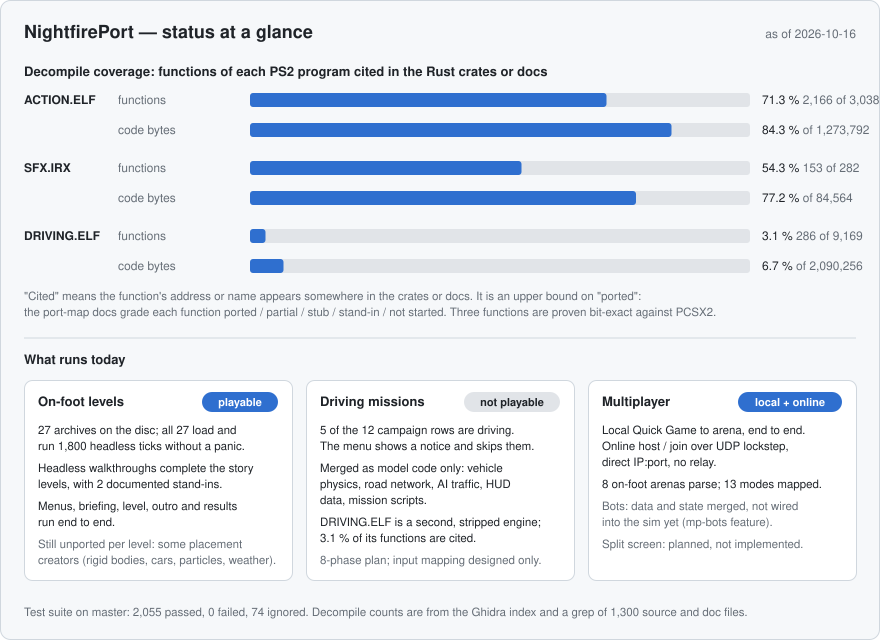
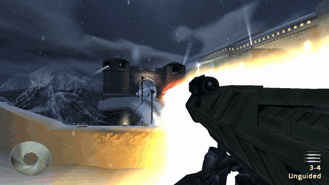
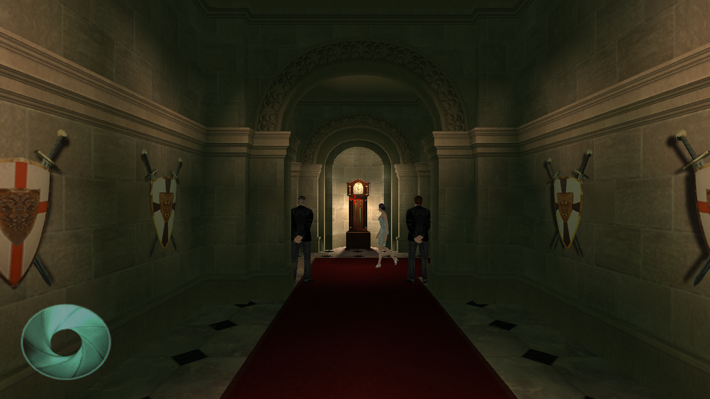
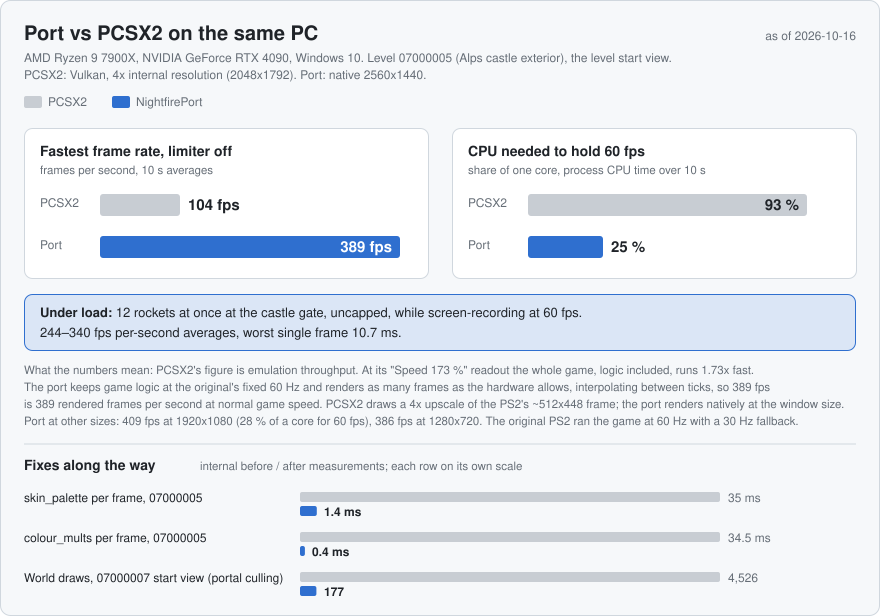
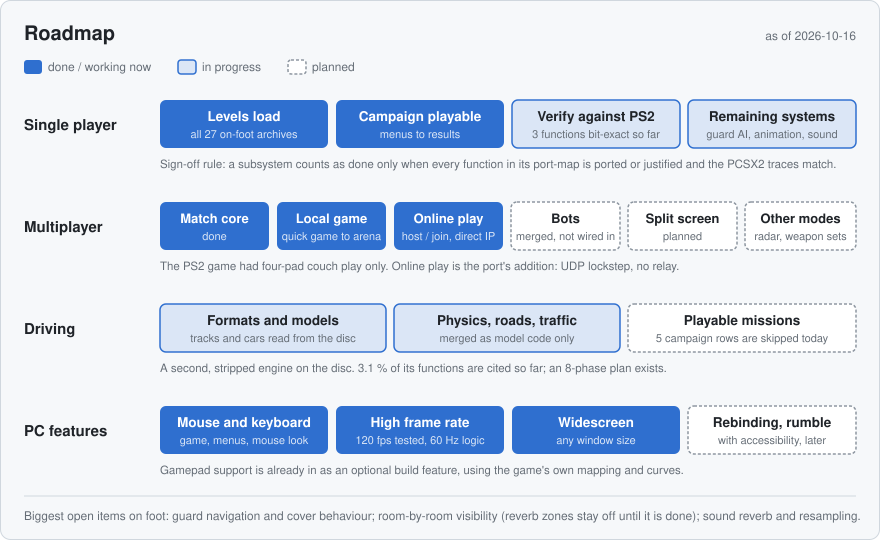

# NightfirePort

A native Rust port of *007: Nightfire* (PlayStation 2, NTSC-U SLUS-20579), rebuilt from the game's own data and logic, with mouse and keyboard as first-class input.


## What this is, and isn't

- It is a port. The game's behaviour is re-implemented in Rust, using a Ghidra decompile of the disc's executables as the reference for what the original code does.
- It is not an emulator and not a static recompiler. No PS2 code runs.
- You need your own disc. The port reads your disc image at run time (`NF_ISO` or a path on the command line). No game files are in this repository, and nothing the tools extract is committed.
- The 2002 PC "Nightfire" is a different game (Gearbox, GoldSrc) and is not involved.

The disc holds two engines: `ACTION.ELF` (Eurocom's on-foot engine; shipped unstripped with 3,038 functions and 5,603 symbols) and `DRIVING.ELF` (EA's EAGL-based driving engine, stripped). The on-foot engine is where almost all of the work has gone so far.

## Status at a glance



In short: the on-foot campaign levels load and run, and most play through end to end (the known blockers are tracked in the gaps list); the driving missions do not; local multiplayer and direct-IP online play work; bots are merged but not wired in; there is no split screen. The front end follows the game's own menu flow, and with the `movies` feature the disc's videos play where the game plays them: the boot logos, the intro, the menu backdrops, and each mission's briefing and outro. Cut-scene faces animate from the game's own morph data.

"Cited" in the graphic is deliberately a loose measure. It counts a function whose address or name appears anywhere in the Rust crates or the docs. The port-map documents hold the stricter per-function grade (ported, partial, stub, stand-in, not started), and the verification ledger currently lists three functions proven bit-exact against recorded PCSX2 calls (`PS2Sinf`, `Quat_QuatToMat`, `Rand_Rand`, 40 of 40 each).

## What the port adds over the PS2 version

Everything below is on top of the game as it shipped. The game's own controller mapping, auto-aim and secret codes are still there.

**High frame rate.** The simulation stays at the game's fixed 60 Hz; rendering interpolates the camera and skin palettes between ticks, so the frame rate is whatever the hardware allows (`--fps N` caps it). The original ran at 60 Hz with a 30 Hz fallback; in PCSX2 98.8 % of measured updates were at 60 Hz.

**Mouse look.** Raw mouse deltas go straight into yaw and pitch (0.0025 rad per count), with no dead zone, curve or ramp. Auto-aim is off by default with a mouse and there is no manual-aim box. The wheel switches weapons (G for gadgets) and zooms while aiming a zoomable weapon.

**Online multiplayer.** The PS2 game is four-pad couch play with no online mode. The port adds Host Online / Join Online pages over a UDP lockstep session in `nf-net`: acks, retransmit, input delay, and a per-tick state hash for desync detection. Direct IP:port, no relay.

**Widescreen and window size.** Gameplay fills the window's aspect; cut-scenes are pillar-boxed at the game's 4:3. The window can be any size.

**Keyboard and mouse menus.** Menu rows are hit-tested where they are drawn.

**Dev tools in a separate window.** With `--dev`, a native "Nightfire dev" window opens beside the game and the game keeps running: weapon and gadget lists, grenades, ammo and health, NPC spawning, teleport, level selection, toggles and screenshots. In the game window, F1 is an AI overlay and F2 a dev menu (god mode, infinite ammo, time scale). There are nine named test scenarios (`--scenario grenade-throw`, `sniper-cover`, `ambush`, `searchlight-tracks-bond`, ...), and input can be recorded and replayed (`--record` / `--replay`).


**Rapid fire.** `--rapid-fire` (or the dev window's Toggles page) makes every weapon fire one round per 60 Hz tick from a full clip, to show what the engine carries: 120 rockets in two seconds, 109 in the air at once. It is off by default, the game's own fire rates apply, and it never applies to an online match.



**Smaller things.** A "keep shell casings" option (the default is the game's own lifetime). Optional gamepad support through gilrs (off by default), running the game's own mapping and curves.

| | |
|---|---|
|  |  |
|  | |

The port's images in this README were rendered by the port at 1280x720; the left half of the comparison clip further down is a PCSX2 capture of the original game.

## Performance



Measured on one PC (Ryzen 9 7900X, RTX 4090) at the start of level 07000005: with the frame limiter off, PCSX2 (Vulkan, 4x internal resolution) reaches 104 fps and the port 389 fps at 2560x1440; holding 60 fps costs PCSX2 93 % of one core and the port 25 %. The two numbers do not mean the same thing: PCSX2's is emulation throughput (at its "173 %" readout the whole game, logic included, runs 1.73x fast), while the port keeps the game logic at a fixed 60 Hz and renders as many interpolated frames as the hardware allows, so 389 fps is rendered frames at normal game speed. PCSX2 is also drawing a 4x upscale of the PS2's ~512x448 frame, where the port renders natively at the window size. Under load, with 12 rockets in the air at the castle gate and a screen recorder running, the port averaged 244–340 fps with a worst single frame of 10.7 ms.

Internally, the biggest fix was the skin palette (35 ms to 1.4 ms per frame on 07000005, on a frame that had been 52 ms in total), followed by portal culling (4,526 to 177 world draws at the start of 07000007); skinning now runs on the GPU and per-frame cost budgets are checked by the test suite.

## Roadmap



The order of work on the on-foot side follows the plan's rule of porting one subsystem whole at a time: core loop, player, weapons, guards (268 functions), objects and levels, then rendering. A subsystem is done when every function in its port-map is ported or justified and the recorded PCSX2 traces match. Multiplayer continues from the finished match core through deathmatch, split screen, bots, the other modes, and radar/panes/weapon sets. The driving engine has its own eight-phase plan and is the furthest out; its levels are skipped in the campaign menu until then. A later polish phase lists FOV, a rebinding UI, rumble and accessibility.

Long-term guardrails from the plan: determinism (a shared bit-exact RNG and a fixed 60 Hz tick), players kept as a list so co-op is possible later, the game's own multiplayer first, and the port's data structures as a future mod format.

## Building and running

You need a Rust toolchain and your own NTSC-U disc image (v1.00).

```
cargo run --release --offline -p nf-view --features movies -- "<path to iso>" 07000005
```

`nf-view [<iso>] <level> [--all] [--seq K] [--frame F] [--fire] [--reinforcements] [--shot out.png ...]`. Without `<iso>` the path comes from `NF_ISO`. `--shot` renders one 1280x720 frame headless and exits.

Controls: WASD to move, mouse to look, left click to fire, R to reload, Space to jump, C or Ctrl to crouch, E to use, F12 for a screenshot, Esc to release the mouse.

Optional cargo features: `gamepad` (gilrs, off by default) and `movies` (the MPEG-2 decoder for the disc's videos). `movies` is off by default to keep plain builds light, but without it no movie plays, so build with `--features movies` to play the game as shipped.

Tests read the disc only when `NF_ISO` is set and are silent (`NF_SILENT=1`):

```
NF_ISO="<path to iso>" cargo test --offline --release -- --test-threads=1
```

The workspace has six crates: `nf-formats` (on-disc format readers), `nf-game` (the fixed-tick simulation ported from `ACTION.ELF`), `nf-view` (window, renderer, menus; the playable app), `nf-audio` (SPU voices mixed in software, played through cpal), `nf-net` (the UDP lockstep session) and `nf-extract` (a 54-subcommand CLI for inspecting your disc: `info`, `manifest`, `elfs`, `files-extract`, `tex-export`, `bigf-extract`, `weapon-matrix`, ...). About 196,000 lines of Rust in total.

## Legal

This project is not affiliated with, endorsed by or connected to the rights holders of *007: Nightfire* or James Bond, nor with the original game's developers or publisher. You must own the game and supply your own disc image. Apart from the screenshots and clips on this page, the repository contains no game data: golden test snapshots hold numbers, hashes and identifiers only, and the research material (decompiles, ELFs, emulator snapshots) lives in a git-ignored directory and is never uploaded.

Code reused from the rerac project (a Rust port of Ratchet & Clank 1, which served as the model for this one) is under its ISC licence; see `THIRD_PARTY_RERAC_LICENSE.txt`.

## How the work is verified

Visual work is checked against the real game side by side: the same scene rendered by the port and captured from PCSX2 at the same spot and timing.


Every claim in the docs carries an evidence tag: **[M]** from the machine code, **[D]** from the disc data, **[L]** from a live PCSX2 snapshot, or **[S]** suggested (not yet backed by evidence). Behaviour is checked against the original by recording PCSX2 calls and traces and comparing numbers, not images, so no game data ends up in the tests; the verification ledger lists what is proven bit-exact.

The test suite has about 2,150 `#[test]` functions across 486 integration test files. The last full run on master was 2,097 passed, 0 failed, 74 ignored (it was 374 tests on 2026-10-12). Per-level walkthrough tests (26 `walk_*` and 35 `walkreal_*` route tests, the latter driving Bond through the real input path) drive each story level headless, every placement on all 27 story levels is checked to resolve, and all 27 on-foot archives run 1,800 ticks without a panic. Per-frame cost budgets are part of the same suite.

Work is tracked in a worklog (549 entries since 2026-10-08), a merge log, a gaps list (50 rows, 34 open or partly open) and an open-questions list (48, of which 36 are still open).
